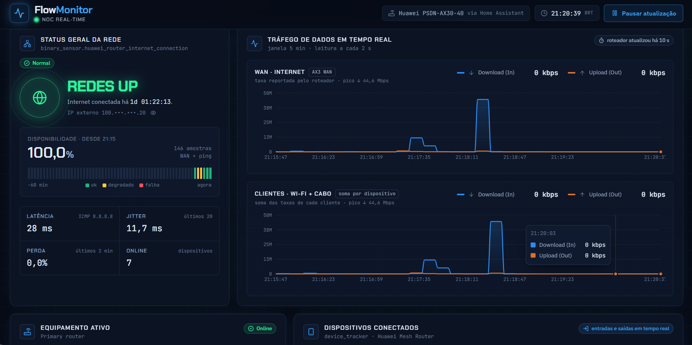
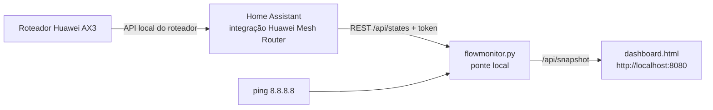

# FlowMonitor · NOC Real-Time

Painel de monitoramento de rede no estilo NOC, feito em React. Tem duas versões:

- **Simulador**: dados gerados no navegador, com tráfego WAN/LAN, roteador MikroTik CCR2004, leases DHCP com contagem regressiva e entrada e saída de dispositivos. Bom para demonstração.
- **Ao vivo**: lê um roteador Huawei de verdade (WiFi AX3 / WS7100 e outros com HarmonyOS) através do Home Assistant e mostra o estado real da rede de casa.



## O que o painel mostra

| Card | Simulador | Ao vivo |
|---|---|---|
| Status geral | REDES UP/DOWN, uptime 24 h, latência, jitter, perda | REDES UP/DOWN pela WAN do roteador, disponibilidade desde o início da coleta, ping real a partir do PC |
| Tráfego | WAN e LAN, Download (In) e Upload (Out), 1 s | WAN reportada pelo roteador e soma dos clientes |
| Equipamento | CCR2004: CPU por núcleo, memória, temperatura, portas | Modelo, firmware, tempo ligado, clientes por banda (2,4 GHz, 5 GHz, cabo) |
| Dispositivos | Rosca por tipo, lease DHCP com timer, expiração automática | Rosca por tipo, banda, sinal, tráfego por cliente, entrada e saída em tempo real |

## Como a versão ao vivo funciona



A ponte (`live/flowmonitor.py`) usa só a biblioteca padrão do Python. Ela encontra as entidades da integração pelos atributos, guarda o histórico em memória, registra entradas e saídas de dispositivos e serve o painel em `127.0.0.1`.

## Rodar o simulador

Abra `simulador/index.html` no navegador.

## Rodar a versão ao vivo (Windows)

1. **Home Assistant em Docker**
   ```powershell
   cd homeassistant
   docker compose up -d
   ```
   Abra http://localhost:8123 e crie a conta.

2. **Integração do roteador.** Copie `custom_components/huawei_mesh_router` do projeto [vmakeev/huawei_mesh_router](https://github.com/vmakeev/huawei_mesh_router) (testado com a v0.9.3.2) para `homeassistant/config/custom_components/`, reinicie o container e adicione **Huawei Mesh Router** em Configurações → Dispositivos e serviços. Nas opções da integração, ligue **Rastreamento de dispositivos** e use intervalo de 10 s.

3. **Token.** No HA: seu usuário → Segurança → Tokens de acesso de longa duração → Criar token.

4. **Painel**
   ```powershell
   cd live
   py flowmonitor.py --check   # confere o que foi encontrado
   py flowmonitor.py           # abre http://localhost:8080
   ```

### Iniciar junto com o Windows

```powershell
setx FLOWMONITOR_HA_TOKEN "seu-token"
```
Depois copie `live/FlowMonitor.cmd` para a pasta Inicializar (`Win + R` → `shell:startup`). O FlowMonitor roda sem janela, espera o Home Assistant subir e abre o painel quando os dados chegam. O log fica em `live/flowmonitor.log`.

### Opções da ponte

| Opção | Para quê |
|---|---|
| `--check` | lista WAN, contadores e dispositivos encontrados no HA |
| `--ha URL` | outro endereço do Home Assistant (padrão `http://localhost:8123`) |
| `--ping 1.1.1.1` | outro alvo de latência |
| `--bind 0.0.0.0` | abrir o painel na rede local (celular) |
| `--service --open` | modo de início automático |

## Limitações conhecidas

- O AX3 informa taxas em kB/s inteiros e a integração lê a cada 10 s, então tráfego muito baixo aparece como 0 e rajadas curtas podem não aparecer.
- O roteador não expõe o tempo restante do lease DHCP; na versão ao vivo a lista mostra há quanto tempo cada cliente está conectado.
- O tipo de dispositivo é estimado pelo nome (iPhone, Redmi, webOS, Hikvision…). Renomear no HA melhora a classificação.
- CPU e temperatura não existem na API do AX3.

## Recompilar o painel

Os componentes ficam em `simulador/FlowMonitor.jsx` e `live/src/FlowMonitorLive.jsx`.

```bash
npm install
npm run build
```

O build gera `simulador/index.html` e `live/dashboard.html`, com React 18, Recharts, lucide-react e Tailwind vindos de CDN.

## Stack

React 18 · Tailwind CSS 3 · Recharts 2 · lucide-react · Python 3 (stdlib) · Home Assistant · Docker

## Créditos

- Integração do roteador: [Huawei Mesh Router](https://github.com/vmakeev/huawei_mesh_router), de vmakeev.
- Projeto de Roger Barbosa, técnico de redes FTTH, com desenvolvimento assistido por Claude.

Licença MIT.
